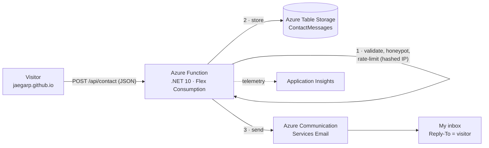

# Portfolio Contact API

Serverless backend for the contact form on **[jaegarp.github.io](https://jaegarp.github.io)** — a C# **Azure Functions** app (.NET 10, isolated worker) that validates enquiries, blocks spam, stores every message in **Azure Table Storage** and emails it to me through **Azure Communication Services**.



## Features

- **Input validation** on the server (name, email, message length) with field-level error messages
- **Spam protection** — hidden honeypot field + per-visitor rate limit (5 / hour)
- **Privacy** — visitor IPs are salted and hashed (SHA-256); the raw address is never stored
- **No lost messages** — every enquiry is stored *before* emailing, so an email outage loses nothing
- **Origin allow-list + CORS** so only the portfolio site can call it from a browser
- **Observability** with Application Insights
- **Infrastructure as code** — one re-runnable script creates every Azure resource ([infra/deploy.ps1](infra/deploy.ps1))
- **Containerised** — runs anywhere with Docker, with the Azurite storage emulator
- **Unit tested** with xUnit

## Project layout

```
ContactApi.slnx                    ← open this in Visual Studio
src/ContactApi/
  Functions/ContactFunction.cs     ← the HTTP endpoint (POST /api/contact)
  Services/ContactValidator.cs     ← validation + honeypot (pure logic)
  Services/MessageStore.cs         ← Azure Table Storage + rate-limit query
  Services/EmailNotifier.cs        ← Azure Communication Services email
  Program.cs                       ← dependency injection & configuration
  local.settings.sample.json       ← copy to local.settings.json for local runs
tests/ContactApi.Tests/            ← xUnit tests
infra/deploy.ps1                   ← creates Azure resources + deploys
Dockerfile, docker-compose.yml     ← container build + local stack
```

## Run it locally

First time only: copy `src/ContactApi/local.settings.sample.json` to `src/ContactApi/local.settings.json`.

### Option 1 — Visual Studio (2022 / 2026)
1. Open **`ContactApi.slnx`**.
2. Make sure **ContactApi** is the startup project (right-click → *Set as Startup Project*).
3. Press **F5**. Visual Studio starts the Azurite storage emulator automatically and runs the API at `http://localhost:7071/api/contact`.
4. Run tests from **Test → Test Explorer → Run All**.

### Option 2 — Docker (no .NET or Azure tools needed)
```bash
docker compose up --build
```
Runs the API **and** the Azurite storage emulator. API at `http://localhost:7071/api/contact`. Stop with `docker compose down`.

### Option 3 — Command line
```bash
func start --script-root src/ContactApi
```
(Needs [Azure Functions Core Tools](https://learn.microsoft.com/azure/azure-functions/functions-run-local) and Azurite running, e.g. `docker compose up azurite`.)

### Try it
```bash
curl -X POST http://localhost:7071/api/contact -H "Content-Type: application/json" -d "{\"name\":\"Test\",\"email\":\"test@example.com\",\"message\":\"Hello from curl!\"}"
```

## Configuration

| Setting | Purpose |
|---|---|
| `AllowedOrigins` | Comma-separated sites allowed to call the API |
| `EnableCors` | `true` only when running outside Azure (Docker); Azure handles CORS itself |
| `MaxMessagesPerHour` | Rate limit per visitor (default 5) |
| `IpHashSalt` | Random text mixed into IP hashes |
| `MessagesStorageConnectionString` | Table Storage for messages (empty = don't store) |
| `CommunicationServicesConnectionString`, `SenderEmail`, `NotifyEmail` | Email delivery (empty = log only) |

## Deploy to Azure

```powershell
az login
./infra/deploy.ps1 -NotifyEmail you@example.com
```
Creates the resource group, storage, Function App (Flex Consumption), Application Insights and Communication Services Email, sets all settings and CORS, then publishes the code. Re-run any time to redeploy. Delete everything with `az group delete -n rg-portfolio-contact`.

**Cost:** at portfolio traffic this sits inside Azure's free grants (Functions Flex Consumption free executions, Application Insights free data); email is a fraction of a cent per message.
