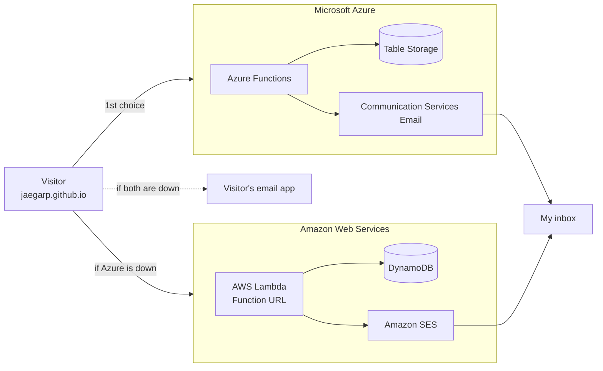

# Portfolio Contact API — multi-cloud (Azure + AWS)

Serverless backend for the contact form on **[jaegarp.github.io](https://jaegarp.github.io)**, written once in C# (.NET 10) and deployable to **both Microsoft Azure and Amazon Web Services**. The website tries Azure first, fails over to AWS, and as a last resort opens the visitor's email app — so an enquiry gets through even during a cloud outage.



## Design

All business logic lives in one cloud-neutral library; each cloud only supplies a thin host plus its own database and email adapters:

| | Shared — `ContactApi.Core` | Azure — `ContactApi` | AWS — `ContactApi.Aws` |
|---|---|---|---|
| Request flow, validation, spam & rate limiting | `ContactService`, `ContactValidator` | | |
| HTTP host | | Azure Functions (isolated worker) | ASP.NET Core minimal API on Lambda |
| Database (`IMessageStore`) | | Table Storage | DynamoDB (+ `ByIp` index) |
| Email (`IEmailNotifier`) | | Communication Services | SES v2 |
| Infrastructure as code | | `infra/deploy.ps1` (Azure CLI) | `infra/aws/template.yaml` (SAM / CloudFormation) |

Both hosts expose the same contract — `POST /api/contact` with `{ name, email, message }` — so the website can call either.

## Features

- **Server-side validation** with field-level error messages
- **Spam protection** — hidden honeypot field + per-visitor rate limit (5 / hour)
- **Privacy** — visitor IPs are salted and SHA-256 hashed; raw addresses are never stored
- **No lost messages** — stored *before* emailing; email failures are logged, not fatal
- **Origin allow-list + CORS**
- **Multi-cloud failover** handled by the website (Azure → AWS → email app)
- **Containerised** — both versions run locally in Docker with the official storage emulators
- **35 unit tests** (xUnit) covering validation and the full request flow with in-memory fakes

## Project layout

```
ContactApi.slnx                      ← open in Visual Studio
src/ContactApi.Core/                 ← shared logic (no cloud dependencies)
src/ContactApi/                      ← Azure Functions host + Table Storage + ACS email
src/ContactApi.Aws/                  ← AWS Lambda host + DynamoDB + SES
tests/ContactApi.Tests/              ← xUnit tests
infra/deploy.ps1                     ← Azure: create resources + deploy
infra/aws/template.yaml              ← AWS: SAM template (Lambda, Function URL, DynamoDB, IAM)
infra/aws/deploy-aws.ps1             ← AWS: verify SES email + sam build + sam deploy
Dockerfile / Dockerfile.aws          ← container builds for each version
docker-compose.yml                   ← local stack (Azurite, DynamoDB Local, both APIs)
```

## Run locally

### Docker (easiest — nothing else to install)
```bash
docker compose up --build                    # Azure version  → http://localhost:7071/api/contact
docker compose --profile aws up --build      # + AWS version  → http://localhost:7072/api/contact
docker compose --profile aws down            # stop everything
```

### Visual Studio
- **Azure version:** set **ContactApi** as startup project → **F5** (Visual Studio starts Azurite automatically). First copy `src/ContactApi/local.settings.sample.json` to `local.settings.json`.
- **AWS version:** start DynamoDB Local (`docker compose --profile aws up -d dynamodb`), set **ContactApi.Aws** as startup project → **F5** → `http://localhost:7072/api/health`.
- **Tests:** Test → Test Explorer → Run All.

### Try it
```bash
curl -X POST http://localhost:7072/api/contact -H "Content-Type: application/json" -H "Origin: http://localhost:5510" -d "{\"name\":\"Test\",\"email\":\"test@example.com\",\"message\":\"Hello from curl!\"}"
```

## Deploy

### Azure
```powershell
az login
./infra/deploy.ps1 -NotifyEmail you@example.com
```

### AWS
```powershell
aws configure            # or: aws login / aws sso login
./infra/aws/deploy-aws.ps1 -NotifyEmail you@example.com
```
The first run sends an **SES verification email** — click the link, then run the script again. New SES accounts are in "sandbox" mode (can only email verified addresses), which is all this API needs since it only emails you.

Then add the printed URLs to `contact.apiUrls` in the website's `js/content.js` — Azure first, AWS second.

## Cost

At portfolio traffic both deployments sit within the providers' free allowances (Azure Functions Flex Consumption, Lambda, DynamoDB on-demand, Application Insights / CloudWatch); email costs a fraction of a cent per message. Remove everything with `az group delete -n rg-portfolio-contact` and `sam delete --stack-name portfolio-contact-api`.
